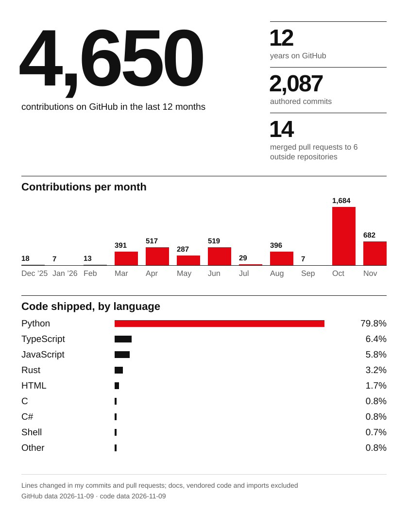

# GbrFrn

Analytics engineer and data scientist with 10+ years of experience. I build
event tracking, data models, experimentation frameworks and the reporting
people actually decide from, and I build the tooling behind online games.

<picture>
  <source media="(prefers-color-scheme: dark)" srcset="assets/profile-dark.svg">
  
</picture>

*If it doesn't change a decision, it's noise.*
